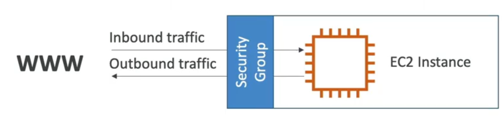

# 03 EC2 Compute

## Index

- [03 EC2 Compute](#03-ec2-compute)
  - [Index](#index)
  - [Module Objectives](#module-objectives)
  - [Fundamental Concepts](#fundamental-concepts)
    - [Instance Families](#instance-families)
    - [Purchasing Models](#purchasing-models)
    - [EC2 User Data and Instance Metadata](#ec2-user-data-and-instance-metadata)
    - [AMIs](#amis)
    - [Security Groups](#security-groups)
    - [Amazon EBS — Elastic Block Store](#amazon-ebs--elastic-block-store)
    - [Instance Store](#instance-store)
    - [Placement Groups](#placement-groups)
    - [Instance Lifecycle](#instance-lifecycle)
  - [Architecture and Components](#architecture-and-components)
  - [Important Exam Configurations](#important-exam-configurations)
  - [Service Comparison](#service-comparison)
  - [Exam Tips and Pitfalls](#exam-tips-and-pitfalls)
  - [For the Exam](#for-the-exam)
  - [Related Links](#related-links)

## Module Objectives

Upon completing this module, you should be able to:

- identify the most suitable EC2 instance family for a given workload
- compare purchasing models and select the most cost-effective one for each usage profile
- differentiate EBS gp3, io2, st1 and sc1 by performance and cost characteristics
- explain the Instance Store vs EBS envelope and their implications in failure scenarios
- choose the correct placement group type for each latency or isolation requirement
- describe IMDSv2 and User Data and apply them in instance automation questions

## Fundamental Concepts

### Instance Families

AWS organizes EC2 instance types into families, and each family is optimized for a hardware characteristic. Recognizing the family by its initial letter is essential on the exam.

**M — General Purpose (balanced)**: balanced ratio of CPU and memory. These are the most common for web applications, medium-sized databases, and development environments. Example: m7g.xlarge.

**C — Compute Optimized**: high CPU performance. Suitable for batch processing, video encoding, HPC servers, game servers, and compute-heavy microservices. Example: c7g.large.

**R — Memory Optimized**: large amount of RAM relative to CPU. Used for in-memory databases such as Redis and Memcached, SAP HANA, real-time analytics. Example: r7g.2xlarge.

**I — Storage Optimized**: high IOPS and low-latency local I/O. Suitable for local NoSQL databases, data warehousing, distributed file systems such as HDFS. Use when temporary data needs ultra-fast access. Example: i4i.xlarge.

**P/G — Accelerated Computing**: GPUs for machine learning, 3D rendering, scientific simulations. P is geared toward ML training and G toward inference and graphics. Example: p4de.24xlarge.

**T — Burstable**: baseline performance with accumulable credits for peaks. Ideal for intermittent workloads such as dev/test environments, low-traffic microservices. T3 and T4g have unlimited mode for unlimited credits at additional cost. Caution: continuous high-CPU workloads exhaust credits and performance drops to baseline.

### Purchasing Models

The purchasing model is one of the most tested topics in cost optimization questions.

**On-Demand**: pay per second or hour without commitment. Highest unit cost, zero planning required. Suitable for unpredictable workloads, development and testing.

**Reserved Instances (RI)**: 1 or 3 year commitment with up to 72% discount vs On-Demand. There are three variants: Standard RI (highest discount, type and region fixed), Convertible RI (lower discount, can change type/OS within the period), and Zonal RI (reserves capacity in a specific AZ). Scheduled RI has been discontinued.

**Savings Plans**: more flexible than Reserved Instances. You commit to an hourly dollar spend for 1 or 3 years. Compute Savings Plans (lower discount, covers EC2, Lambda and Fargate, any type, region and OS) vs EC2 Savings Plans (higher discount, but locked to type and region). There is no concept of a "specific instance"; the discount applies automatically.

**Spot Instances**: purchase of AWS spare capacity with up to 90% discount. AWS may interrupt the instance with 2 minutes notice when it needs the capacity back. Ideal for fault-tolerant workloads: batch, data processing, rendering, CI/CD. Should not be used for stateful databases or applications without checkpointing.

**Spot Fleet**: collection of Spot instances and optionally On-Demand with a target capacity. You define multiple launch pools (type, AZ) and the Fleet selects the cheapest. Strategies: lowestPrice, diversified, capacityOptimized, priceCapacityOptimized (recommended by AWS).

**Dedicated Hosts**: dedicated physical server. You have socket/core visibility, useful for per-socket licensing (SQL Server, Oracle, Windows Server). Can be On-Demand or Reserved.

**Dedicated Instances**: instances that run on dedicated hardware but without specific host control. Covers compliance requiring physical isolation without needing socket visibility.

**Capacity Reservations**: reserves capacity in a specific AZ without a discount commitment. Combines with Savings Plans or Regional RI to cover cost.

### EC2 User Data and Instance Metadata

**User Data** is a script that executes once on the first boot of the instance (via cloud-init). Used to install packages, configure services, and download artifacts. Runs as root. To execute on every boot, it must be explicitly configured via cloud-init or use MIME multi-part.

**Instance Metadata Service (IMDS)** exposes information about the instance at the special endpoint `http://169.254.169.254`. The second version, IMDSv2, is session-oriented and requires a prior call to obtain a token with TTL. The token is then used in the `X-aws-ec2-metadata-token` header in subsequent calls. IMDSv2 protects against SSRF, as the token cannot be captured by an attacker who manages to execute a request via SSRF. The exam tests when to use IMDSv2: whenever the scenario mentions enhanced metadata security or SSRF protection on EC2 instances.

### AMIs

Amazon Machine Images are templates that define the operating system, software configurations, and device mappings of an instance. They can be created from running instances (snapshot of EBS volumes) or directly from EBS volumes.

An AMI can be copied between regions, facilitating multi-region deployment. It can be shared with other accounts or made public. Copying an AMI creates a new EBS snapshot in the destination region. Encrypted AMIs can only be copied to accounts that have access to the CMK used.

For the exam, AMIs typically appear in contexts of launch templates, golden images for consistent bootstrapping, and fast recovery strategies.

### Security Groups

- Security Groups are the fundamental of network security in AWS.
- They control how traffic is allowed into or out of our EC2 instances.
  
- Security Groups only contain `allow` rules.
- Security groups rules can reference by IP or by security group.

### Amazon EBS — Elastic Block Store

EBS provides persistent block volumes for EC2 instances. The volume exists independently of the instance — even if the instance is terminated, the volume can be preserved.

**gp3**: current generation of general-purpose SSD. Baseline of 3,000 IOPS and 125 MBps regardless of size. IOPS and throughput can be scaled independently of size up to 16,000 IOPS and 1,000 MBps. Lower cost than gp2 for additional IOPS.

**gp2**: previous generation. IOPS tied to size: 3 IOPS/GB, minimum 100, maximum 16,000 (requires 5,333 GB volume). Burst capability to 3,000 IOPS using credits. Prefer gp3 for new volumes.

**io2 Block Express**: provisioned IOPS at very high performance. 99.999% durability, consistent latency, up to 256,000 IOPS and 4,000 MBps. Supports multi-attach (multiple instances on the same volume — cluster-aware FS required).

**io1**: previous generation of provisioned IOPS. Up to 64,000 IOPS. Prefer io2 for new cases.

**st1**: throughput-optimized HDD. Good for large sequential data volumes: logs, data lake, Hadoop. Up to 500 MBps. Cannot be a boot volume.

**sc1**: cold HDD. Lowest EBS cost. For rarely accessed data. Up to 250 MBps. Cannot be a boot volume.

EBS Snapshots are incremental and stored in S3 (transparent to the user). The first snapshot copies everything; subsequent ones only changed blocks. They can be copied between regions. Encryption is per volume: if the CMK is specified when creating the volume, all snapshots inherit the encryption.

### Instance Store

Instance Store is temporary storage directly on the physical disks of the server hosting the instance. Very low latency and very high IOPS (NVMe). The downside is that data is lost when the instance is stopped, hibernated, or terminated. Use for cache, buffers, and temporary data that can be recreated — never for permanent data.

### Placement Groups

**Cluster Placement Group**: packs instances physically close together on a rack or group of racks in the same AZ. Minimizes network latency (10 Gbps between instances). Risk: a hardware failure can affect all instances. Suitable for HPC, low-latency applications, and heavy inter-node traffic.

**Spread Placement Group**: distributes instances across distinct hardware. Maximum of 7 instances per AZ per placement group. Maximizes availability: a rack failure affects at most one instance. Suitable for critical applications where each instance cannot share a failure point.

**Partition Placement Group**: divides instances into partitions, each on a separate rack. Up to 7 partitions per AZ and hundreds of instances per group. The application can know which partition each instance is in (via metadata). Suitable for HDFS, HBase, Cassandra, Kafka — distributed systems that have topology awareness.

### Instance Lifecycle

**Stop/Start**: for instances with EBS as root. Data on EBS persists. The instance may be moved to different hardware on restart. The public IP changes (unless using Elastic IP).

**Hibernate**: saves RAM contents to the EBS root volume (which must have sufficient space and be encrypted). The instance can resume from where it stopped, with memory state intact. Faster than a full reboot. Cannot remain hibernated for more than 60 days.

**Terminate**: deletes the instance and, by default, the EBS root volume. Additional volumes can be configured to persist with `DeleteOnTermination=false`.

## Architecture and Components

```text
┌─────────────────────────────────────────────────────┐
│                  EC2 Instance                        │
│                                                      │
│  AMI (boot)                                          │
│  ┌──────────────┐    ┌────────────────────────────┐  │
│  │  EBS Root    │    │       EBS Volumes           │  │
│  │  (gp3/io2)   │    │  data, gp3, io2, st1, sc1  │  │
│  └──────────────┘    └────────────────────────────┘  │
│                                                      │
│  ┌──────────────────────────────────────────────┐    │
│  │   Instance Store (NVMe) — temporary           │    │
│  └──────────────────────────────────────────────┘    │
│                                                      │
│  User Data (cloud-init)                              │
│  IMDS v2 → 169.254.169.254                           │
│  IAM Instance Profile → Role → STS temp credentials │
│                                                      │
│  Security Group (stateful)                           │
└─────────────────────────────────────────────────────┘

Placement Groups:
  Cluster:    [ i1 ][ i2 ][ i3 ]  ← 1 rack, low latency
  Spread:     [ i1 ] ... [ i2 ] ... [ i3 ]  ← distinct racks
  Partition:  P1[ i1,i2 ] P2[ i3,i4 ] P3[ i5,i6 ]  ← racks per partition
```

## Important Exam Configurations

| Item                            | Value             | Notes                             |
| ------------------------------- | ----------------- | --------------------------------- |
| Max Spot discount               | ~90% vs On-Demand | Interruption-tolerant workload    |
| Max Standard RI 3-year discount | ~72%              | All Upfront, same type and region |
| gp3 baseline IOPS               | 3,000             | Independent of size (unlike gp2)  |
| gp3 max IOPS                    | 16,000            | With additional cost per IOPS     |
| io2 Block Express max IOPS      | 256,000           | High-performance volumes          |
| io2 durability                  | 99.999%           | Highest in EBS                    |
| Spread placement max per AZ     | 7 instances       | Per placement group               |
| Hibernation max duration        | 60 days           | RAM saved to encrypted EBS        |
| IMDSv2 default token TTL        | 6 hours           | Configurable at creation          |
| Spot interruption notice        | 2 minutes         | Via metadata and EventBridge      |

## Service Comparison

| Purchasing Model        | Discount       | Commitment              | Ideal for                               |
| ----------------------- | -------------- | ----------------------- | --------------------------------------- |
| On-Demand               | —              | None                    | Unpredictable workload, dev/test        |
| Reserved (Standard)     | up to 72%      | 1 or 3 years            | Stable production, same type            |
| Reserved (Convertible)  | up to 66%      | 1 or 3 years            | Production that may change type         |
| Savings Plans (Compute) | up to 66%      | 1 or 3 years ($ hourly) | EC2 + Lambda + Fargate, any type        |
| Savings Plans (EC2)     | up to 72%      | 1 or 3 years ($ hourly) | EC2 same type and region                |
| Spot                    | up to 90%      | None                    | Batch, CI/CD, fault-tolerant processing |
| Dedicated Host          | variable       | Can be RI               | Per-socket licensing, compliance        |
| Dedicated Instance      | variable + fee | None                    | Physical isolation without host control |

| EBS Type          |                   Use Case | Max IOPS | Max Throughput | Boot? |
| ----------------- | -------------------------: | -------- | -------------: | ----- |
| gp3               |            General purpose | 16,000   |     1,000 MBps | Yes   |
| gp2               |           General (legacy) | 16,000   |       250 MBps | Yes   |
| io2 Block Express | Critical OLTP, low latency | 256,000  |     4,000 MBps | Yes   |
| io1               |  Provisioned IOPS (legacy) | 64,000   |     1,000 MBps | Yes   |
| st1               | Big data, logs, sequential | 500      |       500 MBps | No    |
| sc1               |      Cold, cheap archiving | 250      |       250 MBps | No    |

## Exam Tips and Pitfalls

- T3 burstable in continuous high-CPU workloads will exhaust credits and underperform — Watch out for questions describing unexpected performance degradation.
- Instance Store does not persist after stop or terminate. If the question mentions "temporary high-performance cache data," Instance Store may be the answer; if it mentions persistence, it is not.
- gp2 ties IOPS to size. If you want high IOPS without a large volume, use gp3 (independence between size and IOPS).
- Spot Fleet with `capacityOptimized` strategy reduces interruption risk; `lowestPrice` maximizes savings but increases interruption risk.
- Dedicated Host is for per-socket/core licensing. Dedicated Instance is for physical isolation compliance without host visibility.
- An EC2 public IP changes on every stop/start. For a fixed IP, use Elastic IP.
- Cluster Placement Groups are in a single AZ. If the question asks for multi-AZ distribution, Cluster does not work.
- IMDSv2 is more secure than IMDSv1. AWS recommends IMDSv2 only; in infrastructure security questions, prefer IMDSv2 as the answer.

## For the Exam

- Family M = balanced, C = compute, R = memory, I = storage, T = burstable. If the workload is described, map it to the family.
- Stable long-term production = Reserved or Savings Plans. Unpredictable burst = On-Demand. Interruption-tolerant = Spot.
- High IOPS and consistent latency = io2. Adequate performance and lower cost = gp3. Big sequential data = st1. Minimum cost without performance = sc1.
- Inter-node HPC = Cluster PG. Critical per-instance high availability = Spread PG. HDFS/Cassandra/Kafka with rack awareness = Partition PG.

## Related Links

- [Module Questions](./questions.md)
- [Module Flashcards](./flashcards.md)
- [Module Cheatsheet](./cheatsheet.md)
- [Module Use Cases](./use-cases.md)
- [Module Hands-On Lab](./lab.md)
- [Official Links](./links.md)
- [Module 04: High Availability and Scalability](../05-High-Availability-and-Scalability/)
- [Module 05: Amazon S3 and Storage](../06-Amazon-S3-and-Storage/)

---
