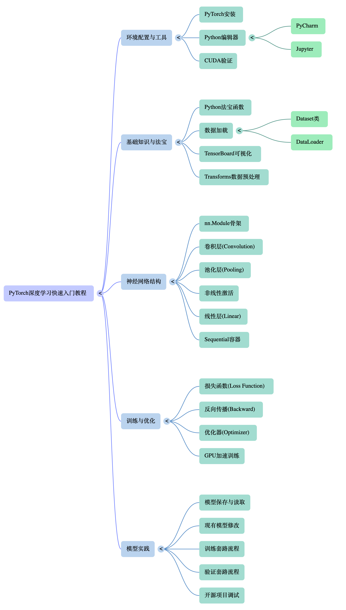

# Learning PyTorch

基于 B 站"**我是土堆**"的《PyTorch 深度学习快速入门教程》整理的学习笔记与代码实践。

> 课程累计播放量超 800 万，以"不废话、接地气"著称，适合零基础入门。

---

## 项目结构

```
learning-pytorch/
├── 01_read_data.py          # 自定义 Dataset
├── 02_tensorboard.py        # TensorBoard 基础
├── 03_transform.py          # torchvision 变换
├── 04_dataset_transform.py  # CIFAR-10 + Transforms + TensorBoard
├── 05_dataloader.py         # DataLoader 批量加载
├── 06_nn_module.py          # nn.Module 基础
├── 07_nn_conv.py            # 卷积层 Conv2d
├── 08_nn_maxpool.py         # 最大池化 MaxPool2d
├── 09_nn_relu.py            # 激活函数 ReLU / Sigmoid
├── 10_nn_linear.py          # 全连接层 Linear + Flatten
├── 11_nn_seq.py             # nn.Sequential 完整 CNN
├── 12_nn_loss.py            # 损失函数 L1Loss
├── 13_loss_network.py       # CrossEntropyLoss + 反向传播
├── 14_nn_optimizer.py       # SGD 优化器 + 完整训练循环
└── data/
    ├── cifar-10-batches-py/ # CIFAR-10 数据集
    └── hymenoptera_data/    # 蚂蚁 vs 蜜蜂分类数据集
```

---

## 核心概念

### 1. Dataset 与 DataLoader

PyTorch 的数据管道分两层：

- **Dataset** — 定义"如何读取单条数据"，需实现 `__len__` 和 `__getitem__`
- **DataLoader** — 在 Dataset 之上封装批量加载、打乱、多进程等能力

```python
# 自定义 Dataset
class MyDataset(Dataset):
    def __init__(self, root): ...
    def __len__(self): return len(self.files)
    def __getitem__(self, idx): return image, label

# DataLoader 包装
loader = DataLoader(dataset, batch_size=64, shuffle=True, drop_last=True)
```

### 2. Transforms（数据变换）

对图像进行预处理的标准流水线，常用操作：

| Transform | 作用 |
|---|---|
| `ToTensor()` | PIL/ndarray → Tensor，像素值归一化到 [0,1] |
| `Resize(n)` | 调整图像尺寸 |
| `Normalize(mean, std)` | 标准化，加速收敛 |
| `Compose([...])` | 串联多个变换 |

### 3. TensorBoard 可视化

用于监控训练过程，支持标量、图像、模型图等：

```python
from torch.utils.tensorboard import SummaryWriter

writer = SummaryWriter("logs")
writer.add_scalar("Loss/train", loss, global_step)
writer.add_image("input", img_tensor, step)
writer.add_graph(model, input_tensor)
writer.close()
```

启动：`tensorboard --logdir=logs`

### 4. nn.Module（神经网络基类）

所有自定义网络都继承自 `nn.Module`，必须实现 `forward` 方法：

```python
class Greg(nn.Module):
    def __init__(self):
        super().__init__()
        self.conv = nn.Conv2d(3, 32, 3, padding=1)

    def forward(self, x):
        return self.conv(x)
```

### 5. 卷积层 Conv2d

卷积核在输入特征图上滑动，提取局部特征。

关键参数：

| 参数 | 含义 |
|---|---|
| `in_channels` | 输入通道数（RGB=3） |
| `out_channels` | 输出通道数（卷积核数量） |
| `kernel_size` | 卷积核大小 |
| `stride` | 步长，控制滑动间距 |
| `padding` | 边缘填充，保持尺寸 |

输出尺寸公式：`H_out = (H_in + 2×padding - kernel_size) / stride + 1`

### 6. 池化层 MaxPool2d

对特征图降采样，保留最显著特征，减少计算量：

```python
nn.MaxPool2d(kernel_size=2, stride=2)  # 尺寸减半
```

`ceil_mode=True` 时，边缘不足一个窗口也保留（向上取整）。

### 7. 激活函数

引入非线性，使网络能拟合复杂函数：

| 函数 | 特点 |
|---|---|
| `ReLU` | `max(0, x)`，计算快，缓解梯度消失，最常用 |
| `Sigmoid` | 输出 (0,1)，适合二分类输出层 |

### 8. 损失函数

衡量预测值与真实值的差距：

| 损失函数 | 适用场景 |
|---|---|
| `L1Loss` | 回归，对异常值鲁棒 |
| `MSELoss` | 回归，惩罚大误差 |
| `CrossEntropyLoss` | 多分类（内含 Softmax） |

### 9. 优化器与训练循环

标准 PyTorch 训练循环（四步走）：

```python
optimizer = torch.optim.SGD(model.parameters(), lr=0.01)

for epoch in range(epochs):
    for imgs, labels in dataloader:
        optimizer.zero_grad()      # 1. 清空梯度
        outputs = model(imgs)      # 2. 前向传播
        loss = criterion(outputs, labels)  # 3. 计算损失
        loss.backward()            # 4. 反向传播
        optimizer.step()           # 5. 更新参数
```

---

## 完整数据流

```
原始图像文件
     │
     ▼
 Dataset.__getitem__()
  └─ 读取图像 + 标签
  └─ 应用 Transforms（ToTensor, Normalize...）
     │
     ▼
 DataLoader
  └─ 批量打包（batch_size）
  └─ 随机打乱（shuffle）
     │
     ▼
 Model.forward()
  └─ Conv2d → MaxPool2d（×3）
  └─ Flatten
  └─ Linear → Linear（输出 10 类）
     │
     ▼
 Loss Function（CrossEntropyLoss）
     │
     ▼
 loss.backward()  ←  计算梯度
     │
     ▼
 optimizer.step()  ←  更新权重
```

---

## 本项目 CNN 架构（Greg 模型）

贯穿 06–14 文件的统一模型，用于 CIFAR-10 十分类：

```
输入: [B, 3, 32, 32]
  │
  ├─ Conv2d(3→32, k=5, p=2)  →  [B, 32, 32, 32]
  ├─ MaxPool2d(2)             →  [B, 32, 16, 16]
  │
  ├─ Conv2d(32→32, k=5, p=2) →  [B, 32, 16, 16]
  ├─ MaxPool2d(2)             →  [B, 32, 8, 8]
  │
  ├─ Conv2d(32→64, k=5, p=2) →  [B, 64, 8, 8]
  ├─ MaxPool2d(2)             →  [B, 64, 4, 4]
  │
  ├─ Flatten                 →  [B, 1024]
  ├─ Linear(1024, 64)        →  [B, 64]
  └─ Linear(64, 10)          →  [B, 10]  ← 10 类输出
```

---

## macOS 适配说明

课程中的 GPU 训练代码（`.cuda()`）在 macOS 上需替换为：

```python
# 自动选择设备
device = torch.device("mps" if torch.backends.mps.is_available() else "cpu")
model = model.to(device)
imgs, labels = imgs.to(device), labels.to(device)
```

Apple Silicon（M1/M2/M3）通过 MPS 后端可获得显著加速。

---

## 学习路径建议

```
土堆课程（掌握工具）  →  Karpathy 课程（理解原理）
      │                          │
  学会调用 API               理解反向传播数学
  搭建训练工作流             从零实现神经网络
  跑通第一个 CNN             进阶到"懂原理"
```


